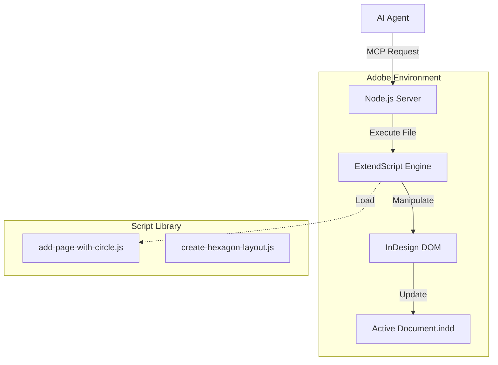

# InDesign MCP — Layout Orchestration Bridge

InDesign MCP is a specialized Model Context Protocol (MCP) server that provides AI agents with a powerful interface for programmatically controlling Adobe InDesign. It enables LLMs to generate complex layouts, apply sophisticated styling, and manage document assets through standard RPC calls.

## Concepts & Architecture

The system operates as a **DOM Automation Bridge**, translating semantic agent intents (e.g., "Create a hexagonal grid") into imperative ExtendScript commands that manipulate the InDesign Object Model.

### The Orchestration Cycle
1.  **Agent Request**: The AI sends a high-level command via MCP (e.g., `create_layout`).
2.  **Script Synthesis/Selection**: The server selects the appropriate `.js` automation script (`src/scripts/`) or synthesizes parameters for a dynamic layout function.
3.  **ExtendScript Execution**: The command is executed within the Adobe InDesign context, manipulating Pages, Spreads, and Geometric Bounds.
4.  **Visual Feedback**: The script returns the new state of the document, allowing the agent to "see" (via object properties) what it built.

## Technical Implementation

### Core Technology Stack
| Layer | Technology | Purpose |
| :--- | :--- | :--- |
| **Server** | Node.js | Asynchronous MCP lifecycle management |
| **Automation** | Adobe ExtendScript (ES3) | Native InDesign scripting API |
| **Protocol** | Model Context Protocol | Standardized tool negotiation |
| **Geometry** | JavaScript Math | Calculating complex layout coordinates (Hexagons, Grids) |

### Key Modules
- **`index.js`**: The primary server entrypoint handling standard input/output for the agent.
- **`create-hexagon-layout.js`**: A complex algorithm for generating mathematically perfect tessellated layouts.
- **`apply-spectralab-styles.js`**: An automation tool for enforcing brand consistency (Colors, Paragraph Styles) across a document.

## Core Research Pillars

- **Generative Layout Systems**: moving beyond "templates" to algorithmic layouts where the grid itself is generated based on the content density.
- **Semantic Style Mapping**: Allowing agents to apply "Warm & Friendly" styling by mapping semantic concepts to specific paragraph styles and swatches.
- **Automated Pre-Flight**: Agents that can check a document for print errors (Bleed, Resolution) and auto-correct them.

## Future Research & Ideas

- **Visual Feedback Loop**: Integrating a mechanism to export a JPEG snapshot of the current spread back to the agent for visual verification.
- **Natural Language Styler**: "Make the headline pop more" -> Agent adjusts leading, tracking, and color tint automatically.
- **Asset Hallucination**: An agent that acts as a "content placeholder" generator, filling frames with synthetic text and images during the wireframing phase.
